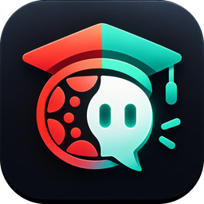

# Canvas Assistant

Canvas LMS와 Codex(ChatGPT)를 연결한 Windows·macOS용 개인 학습 비서입니다. 과제 마감, 공지, 성적을 한 화면에서 보고, AI에게 물어보면 실제 Canvas 데이터를 조회해서 답합니다.

<p align="center"></p>

## 주요 기능

- **AI 대화**: "이번 주 마감 과제 정리해줘", "최근 공지 요약해줘"처럼 물어보면 Codex가 Canvas 도구 47개와 파일 만들기 도구로 직접 조회해서 답합니다. 강의자료(PDF·PPT·Word·한글·코드)와 내가 낸 제출물의 **내용까지 읽고** 답합니다. 입력창의 🧰 버튼으로 도구를 직접 실행해 결과를 첨부할 수 있고, 대화는 보관·삭제할 수 있습니다.
- **AI가 만든 파일 받기**: PDF·Word·ZIP·코드·CSV 등을 AI에게 만들어 달라고 하면 `다운로드/Canvas Assistant/AI 생성`에 저장되고 대화에서 바로 열 수 있습니다.
- **우클릭 메뉴**: 과제·공지·파일·강의를 우클릭해 AI 채팅에 추가, 바로 분석, 제출, 완료 표시.
- **LearningX 강의자료실**: 강의자료실이 LearningX(외부 도구)인 학교도 앱에서 자료 목록·내용 보기·다운로드·AI 요약이 됩니다.
- **과제 제출**: 파일(여러 개)·텍스트·URL 제출과 코멘트를 앱에서 바로. 남은 제출 횟수·허용 형식을 먼저 확인합니다.
- **메시지함**: Canvas 메시지 읽기, 답장, 새 메시지.
- **Canvas 대시보드**: 다가오는 과제(남은 시간·제출 여부), 강의별 현재 점수, 최근 7일 공지를 한눈에 봅니다. 강의를 열면 학교 Canvas와 같은 메뉴(홈, 수업 계획서, 강의자료실, 게시판, 주차학습, 과제 및 평가, 성적 등)가 나오고, 외부 도구 메뉴는 브라우저로 엽니다. 파일은 `다운로드/Canvas Assistant` 폴더로 받습니다.
- **승인 대기**: AI는 Canvas를 직접 바꾸지 않습니다. 과제 제출, 토론 댓글, 할 일·일정 추가는 요청으로만 올라오고, 앱에서 승인해야 실행됩니다. 모든 실행은 활동 기록에 남습니다.
- **자동화와 알림**: 마감 임박(기본 24시간·3시간 전), 새 공지, 새 성적을 데스크톱 알림으로 알려줍니다. 원하면 매일 정한 시각에 AI 브리핑을 받을 수 있습니다.
- **트레이·자동 시작**: 창을 닫아도 트레이(macOS는 메뉴 막대)에서 계속 동작하고, 컴퓨터를 켤 때 자동 실행할 수 있습니다.

## 설치

**Windows**
1. [Releases](../../releases)에서 `CanvasAssistant-x.y.z-windows-x64-setup.exe`를 받아 실행합니다. 관리자 권한 없이 현재 사용자에게 설치됩니다.
2. 코드 서명이 없어서 처음 실행할 때 "Windows의 PC 보호" 창이 뜨면 **추가 정보 → 실행**을 누르세요.

**macOS**
1. Apple Silicon(M1~M4)은 `…-macos-arm64.dmg`, Intel Mac은 `…-macos-x64.dmg`를 받아 앱을 응용 프로그램 폴더로 옮깁니다.
2. 서명·공증이 없어서 처음 열 때 막히면 **시스템 설정 → 개인정보 보호 및 보안 → 그래도 열기**를 누르세요.

Codex는 앱에 포함되어 있어서 따로 설치할 필요가 없습니다.

요구 사항: Windows 10/11 64비트(WebView2는 설치 프로그램이 자동 설치) 또는 macOS 11 이상, ChatGPT 계정(AI 기능), 학교 Canvas 계정.

## 처음 설정

1. **설정 → Canvas 연결**에 학교 Canvas 주소(예: `canvas.학교.ac.kr`)를 입력합니다.
2. **토큰 발급 페이지 열기**를 눌러 Canvas의 *계정 → 설정 → 새 액세스 토큰*에서 토큰을 만들고 붙여넣은 뒤 **연결**을 누릅니다. 연결을 확인한 뒤에만 저장됩니다.
3. **설정 → ChatGPT 계정**(또는 AI 대화 화면)에서 **ChatGPT로 로그인 (브라우저)** 를 누릅니다. 브라우저 로그인이 안 되면 **기기 코드로 로그인**을 쓰세요.

## 보안과 개인정보

- Canvas 토큰은 **Windows 자격 증명 관리자**(macOS는 **키체인**)에만 저장됩니다. 설정 파일·로그·화면에 남지 않고, 토큰은 설정한 Canvas 주소로만 전송됩니다(다른 도메인으로 가는 페이지 링크나 리다이렉트에는 보내지 않음).
- ChatGPT 로그인은 앱에 포함된 Codex가 처리하고, 로그인 정보는 자격 증명 관리자(macOS는 키체인)에 저장됩니다. Codex는 앱 전용 폴더(Windows `%APPDATA%\com.sopo9880.canvasassistant\codex`, macOS `~/Library/Application Support/com.sopo9880.canvasassistant/codex`)를 써서 PC에 따로 설치된 Codex와 섞이지 않습니다.
- AI는 **읽기 전용 샌드박스**에서 실행되고 셸 도구·웹 검색이 꺼져 있습니다. 명령 실행·파일 수정 요청은 항상 거절되고, AI가 쓸 수 있는 도구는 Canvas 조회, '변경 제안', 새 파일 만들기(make_file)뿐입니다. make_file은 `AI 생성` 폴더 안에만 새 파일을 만들고, 실행 파일은 만들지 않으며 기존 파일을 덮어쓰지 않습니다.
- LearningX 연결은 Canvas의 일회용 외부 도구 실행 주소로 하고, Canvas 토큰은 LearningX·자료 서버로 보내지 않습니다. LearningX 쿠키는 메모리에만 두고 20분 뒤 버립니다.
- Canvas를 바꾸는 작업은 모두 **승인 대기**를 거칩니다. 한 요청은 한 번만 실행됩니다.
- 앱 데이터(설정, 승인 대기열, 알림 기록)는 `%APPDATA%\com.sopo9880.canvasassistant`에 있습니다.

## 구조

| 경로 | 내용 |
|---|---|
| `src/` | React UI (대화, Canvas, 승인 대기, 자동화, 설정) |
| `src-tauri/src/codex.rs` | `codex app-server` JSON-RPC 브리지 (허용 목록, 읽기 전용 강제, Codex 실행 파일 탐색) |
| `src-tauri/src/canvas.rs` | Canvas REST 클라이언트 (페이지네이션, 요청 한도 재시도, 토큰 출처 제한, 쓰기 작업) |
| `src-tauri/src/canvas_ext.rs` | 강의 탭·계획서·플래너·제출 이력·토론·메시지함 등 조회, 파일 업로드 제출, 나머지 쓰기 작업 |
| `src-tauri/src/extract.rs` | 파일 텍스트 추출 (PDF, Office, 한글, 코드, ZIP, ipynb) |
| `src-tauri/src/materials.rs` | Canvas 파일·내 제출물 내용 읽기 |
| `src-tauri/src/learningx.rs` | LearningX 강의자료실 (LTI 실행, 메모리 쿠키, 자료 목록·다운로드) |
| `src-tauri/src/generate.rs` | AI가 만드는 파일 (PDF, DOCX, ZIP, 텍스트·코드) |
| `src-tauri/src/mcp.rs` | Codex가 실행하는 Canvas MCP 서버 (`canvas-assistant.exe --mcp-canvas`) |
| `src-tauri/src/db.rs` | SQLite: 승인 대기열, 예약 작업, 알림 중복 방지, 활동 기록 |
| `src-tauri/src/scheduler.rs` | 마감·공지·성적 알림과 AI 브리핑 |
| `src-tauri/src/config.rs` | 설정 파일과 자격 증명 관리자 토큰 |
| `preview/` | 브라우저에서 UI를 확인하는 개발용 미리보기 (가짜 데이터) |

## 개발

```bash
npm ci
npm run fetch:codex           # 설치 파일에 넣을 codex.exe 받기 (package.json codexVersion)
npm test                      # 저장소 규칙 테스트
cargo test --manifest-path src-tauri/Cargo.toml   # Rust 단위·통합 테스트
npm run tauri dev             # 앱 실행 (Windows)
npm run ui:preview            # 브라우저 UI 미리보기: http://127.0.0.1:5199/?view=canvas
```

Windows에서 개발하려면 Rust stable, Node 22+, Visual Studio C++ Build Tools, WebView2가 필요합니다.

## 빌드와 릴리스

- **Windows에서**: `npx tauri build --bundles nsis`
- **macOS에서**: `node scripts/fetch-codex.mjs --target darwin-arm64`(Intel은 `darwin-x64`) 후 `npx tauri build --bundles app,dmg`
- **Linux에서 크로스 빌드**: `npm run build:win-cross` → `release/`에 설치 파일과 `SHA256SUMS.txt`가 생깁니다 (MinGW, NSIS 필요. 자세한 내용은 스크립트 주석 참고).
- **GitHub Actions**: *Release* 워크플로를 수동 실행하면 Windows 설치 파일과 macOS dmg(Apple Silicon·Intel)를 빌드해 한 릴리스로 올립니다. 비공개 저장소에서는 macOS 사용 시간이 10배로 계산되니, 필요하면 `platforms` 입력으로 한쪽만 빌드하세요.

버전은 `package.json`, `src-tauri/Cargo.toml`, `src-tauri/tauri.conf.json` 세 곳을 함께 올립니다 (`npm test`가 일치 여부를 확인합니다).

## 알려진 제한

- 비공개 저장소에서는 자동 업데이트를 쓸 수 없어서, **설정 → 업데이트 확인**은 릴리스 페이지를 안내합니다. 저장소를 공개로 바꾸면 자동 확인이 동작합니다.
- 알림과 자동화는 앱(또는 트레이)이 실행 중일 때만 동작합니다.
- 500MB보다 큰 파일, 미디어 녹화, 외부 도구(LTI) 과제는 Canvas 웹에서 제출해야 합니다.
- 퀴즈 응시는 Canvas에서 합니다 (AI 대리 응시는 지원하지 않음).

Canvas는 Instructure의 상표이며, 이 프로젝트는 Instructure나 OpenAI와 관계없는 개인 프로젝트입니다.
